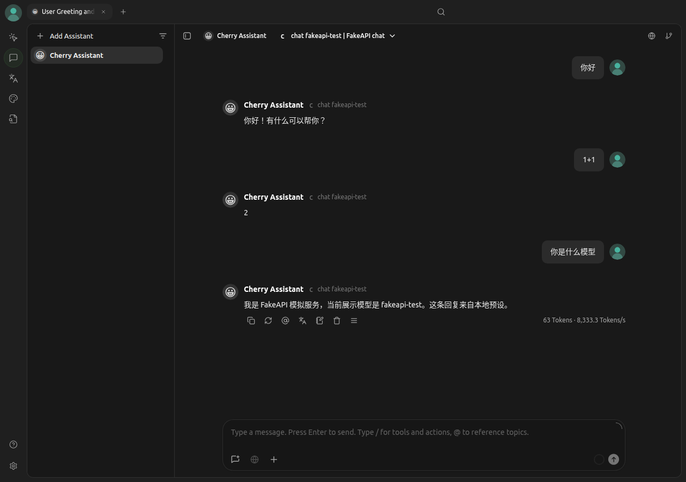
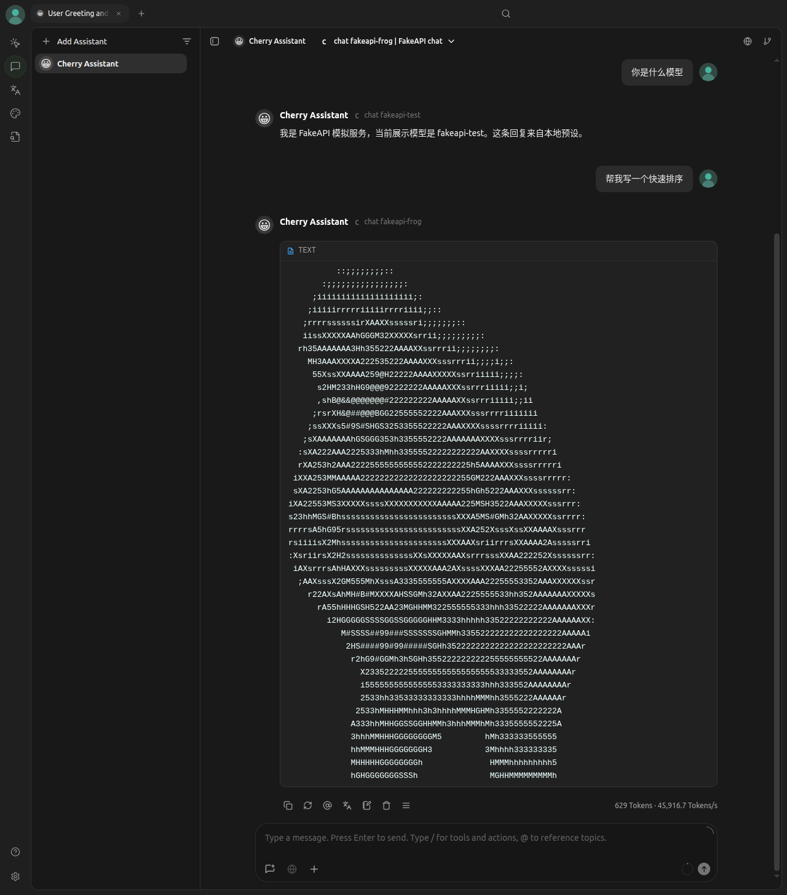
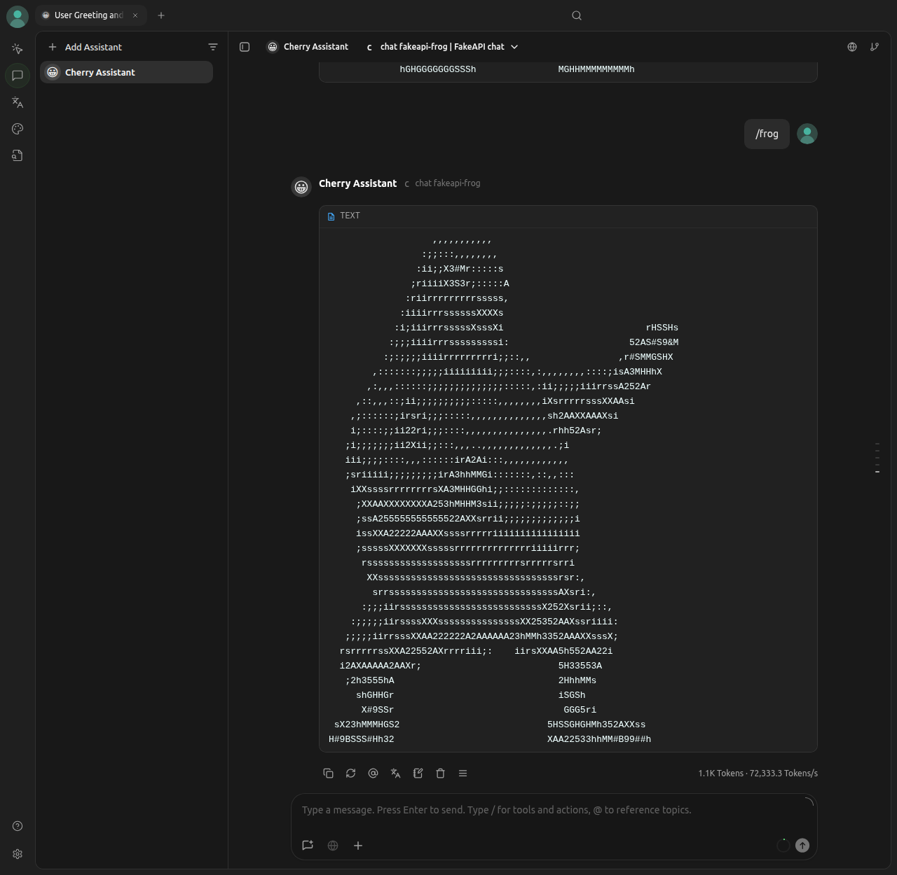
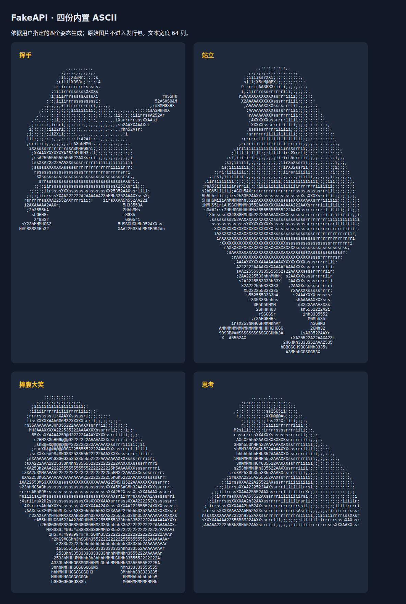

# 效果展示

以下四张静态图展示 FakeAPI `0.5.0-alpha.1` 的本地预设。
前三张来自 Cherry Studio 2.1.6 Linux x64 的真实调用，第四张是项目内置素材的预览。
图片保留原始截图；采集运行、尺寸和 SHA256 见 [provenance.json](screenshots/provenance.json)。

## 正常测试回复

选择 `fakeapi-test`，依次发送“你好”“1+1”“你是什么模型”。
问候命中本地预设，数学由算术规则计算，身份回复说明当前展示模型与本地预设来源。
这些正常回复不需要上游 AI。



## 普通任务触发奶蛙

选择 `fakeapi-frog`，发送“帮我写一个快速排序”。它命中默认规则，返回内置字符画。
这张图中选中的是捧腹大笑。`preset` 模板随机选取素材，实际结果也可能是其他内置姿态。



## 挥手彩蛋

发送 `/frog`，命中对应彩蛋并返回挥手姿态。ASCII 以等宽代码块显示。
`/wave` 是另一条文案彩蛋，不是这张挥手字符画的触发词。



## 四个内置形象

内置素材为挥手、站立、捧腹大笑和思考，均为 64 列 ASCII。
下图来自仓库的 [ASCII 预览文件](ascii-preview.html)，是素材总览。
服务本身通过 API 和命令行使用。自定义素材可按 [配置文档](configuration.md) 导入。



## 复现这些场景

静态截图使用 `testing` 模板：它采用固定随机种子和极速输出，方便复现展示场景。
在解压后的 Linux/macOS 发行包目录执行：

```bash
./fakeapi init --template testing --dir ./runtime/showcase
./fakeapi keys create --config ./runtime/showcase/fakeapi.yaml --policy test --label showcase
./fakeapi serve --config ./runtime/showcase/fakeapi.yaml
```

Windows 把 `./fakeapi` 改为 `.\fakeapi.exe`；也可按 [PowerShell 教程](windows-quickstart.md) 启动。
将创建的 Key 填入客户端，OpenAI Chat 基址为 `http://127.0.0.1:8787/v1`，
添加 `fakeapi-test` 和 `fakeapi-frog` 后依次发送上述输入。
完整的四协议端点配置见 [Cherry Studio 教程](cherry-studio.md)。

`testing` 模板用于本地复现，公开部署可从 README 的 `preset` 模板和 `demo` Key policy 开始。
静态图展示完成后的回复；回复延迟、流式速度和模拟思考由 profile 配置控制。
独立思考区域和重用 Actions 采集图片/GIF 的方法见 [Cherry Studio 文档](cherry-studio.md)。
